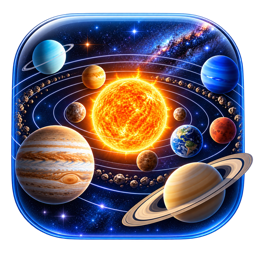

# Sistema Solar 3D para macOS

**Português** · [English](#solar-system-3d-for-macos)

Uma simulação 3D interativa e educativa do Sistema Solar para o Mac: planetas, planetas anões, luas, a ISS, sondas,
eclipses, visita guiada com voz e posições reais calculadas com dados da NASA/JPL.

**Transferir:** [sist-solar-3d.netlify.app/mac](https://sist-solar-3d.netlify.app/mac) — ou a [release mais recente](https://github.com/nh7q9b5wfc-web/sistema-solar-3d-mac/releases/latest).

- Requisitos: macOS 15 Sequoia ou mais recente, Mac com chip Apple ou Intel.
- A app não está assinada com uma conta paga da Apple: na primeira abertura siga os passos do «Leia-me» que vem no DMG
  (Definições do Sistema › Privacidade e segurança › Abrir na mesma).
- Também funciona no navegador, sem instalar: [sist-solar-3d.netlify.app](https://sist-solar-3d.netlify.app).

Este repositório só tem as versões da app para transferir; não tem o código.

---

# Solar System 3D for macOS

An interactive, educational 3D simulation of the Solar System for the Mac: planets, dwarf planets, moons, the ISS,
space probes, eclipses, a narrated guided tour and real positions computed from NASA/JPL data.

**Download:** [sist-solar-3d.netlify.app/mac](https://sist-solar-3d.netlify.app/mac?lang=en) — or the [latest release](https://github.com/nh7q9b5wfc-web/sistema-solar-3d-mac/releases/latest).

- Requirements: macOS 15 Sequoia or later, on a Mac with Apple silicon or an Intel processor.
- The app is not signed with a paid Apple account: the first time you open it, follow the steps in the “Read me” inside
  the DMG (System Settings › Privacy & Security › Open Anyway).
- It also runs in the browser, with nothing to install: [sist-solar-3d.netlify.app](https://sist-solar-3d.netlify.app).

This repository only holds the app versions to download; it does not contain the source code.
